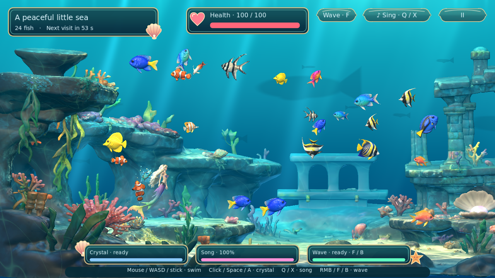

# Sabrinina podvodna bajka

*Sabrina’s Underwater Fairy Tale*

A little mermaid, a magic crystal, and a living aquarium. This is a 3D remake of the [original Scratch game](https://scratch.mit.edu/projects/1203591608/), currently built with native C++ and Godot. It preserves the original side-on swimming view in a three-dimensional reef.

## Credits and origin

- **Development and remake:** Luka Dežulović
- **Original idea:** Sabrina Dežulović

The game began in Scratch from an idea by Sabrina Dežulović. Luka Dežulović is remaking that little underwater world in 3D, preserving its mermaid magic, tropical fish and calm aquarium moments. [Play the original on Scratch](https://scratch.mit.edu/projects/1203591608/).

This version replaces the original story screen and intro narration with brief credits and the remake’s history.



## Current build

A playable desktop prototype with a shell-and-coral interface, pearl borders and a bundled font for Croatian diacritics. The reef and Sabrina use optimized, textured Blender assets adapted from the supplied models. Twelve tropical fish designs and the jellyfish also use editable Blender sources with skinned skeletons and animation clips; artwork and balancing are still in development.

- Persistent tropical fish with twelve detailed models, varied sizes, shaped bodies, ribbed fins, gills and reflective scales. They cruise in gentle arcs, slow into broad turns, and accelerate along their heading. Skeletal tail beats follow swimming effort, and left-facing fish pitch correctly.
- A textured Sabrina with blonde hair, a rainbow shell costume and a flowing rainbow scale tail. Her neutral-pose mesh has a 32-bone Blender rig with collarbones, controlled elbows and wrists, bounded head movement and eight editable animation clips.
- Expressive jellyfish with scalloped bells, wandering eyes and flowing tendrils. Every eaten fish increases their size and contact area. Their whole bell and tentacle area is dangerous.
- Moving, soft-edged silhouettes of distant fish, sharks, rays and whale-like visitors, with varied sizes and depths. No static distant shoal.
- Peaceful fish-spawning intervals between jellyfish visits. An unlimited quiet aquarium mode is also available.
- A crystal that charges, travels towards a jellyfish, returns touched fish to Sabrina, and rests before the next cast.
- Siren song gathers nearby fish within a shrinking radius, consumes energy, and locks until fully recharged if exhausted. Stop early to conserve energy; even distant jellyfish sometimes hear it and approach.
- A directional water wave pushes groups of fish with a short 3 / 4-second recharge. Right-click, F, controller B or the HUD button casts it from Sabrina’s hands. Jellyfish are unaffected; ordinary contact still gently nudges fish.
- Occasional multiple jellyfish on later visits, limited to one, two or three in settings.
- English, Croatian and Italian interface and credits, original jellyfish recordings, siren song and magic effects, plus synthesized melodic music.
- Fullscreen on first launch; saved graphics, sound, language, pacing and difficulty preferences.
- Vibrant layered coral, moving caustics, depth-integrated underwater sunbeams, textured reef plants and changing sunlight. The water scattering approximation runs on both Mobile and Compatibility renderers with 3/6/12 depth samples by quality setting.
- Sabrina uses the rigged neutral-pose figure with a six-joint tail wave, flexible fluke tips, relaxed arm strokes and delayed hair motion. Her spine stays quieter, her neck follows dives, and her arms trail alongside the torso with small elbow and palm movements. She rises into a resting tread, tilts into climbs and dives, and turns smoothly through a half-circle. Reduced motion slows her stroke.
- Fish gently rebound from one another and Sabrina’s body, arms and moving tail. Water drag settles each bump and fish steer away afterwards. Magically travelling fish retain their rescue paths.
- Foreground coral and rocks in the lower-left corner naturally hide passing creatures; distant reef textures soften into underwater haze.
- Custom Sabrina boot artwork and a staged loading screen with a brief remake origin and author copyright.

## Play

Swim among the fish. When a hungry jellyfish visits, guide fish away or use the crystal to send her away. Fish remain in the aquarium after the encounter, and new fish arrive only after every jellyfish has left the screen. Scheduled spawning and empty-aquarium refills both pause while any jellyfish is arriving, feeding or departing. Sabrina starts with 100 health. A sting flashes her red, stuns her and removes 28 health in Gentle mode or 35 in Lively. After eight safe seconds, health regenerates at 1.2 / 0.8 points per second. Zero health opens a game-over screen with retry and menu choices. Quiet aquarium remains peaceful.

Arriving and hungry jellyfish eat unprotected fish on contact, including multiple simultaneous contacts. Fish flash red, swell and pop into particles. Crystal rescue gives a visible four-second protective bubble, including transit time; protected fish still bump against the jellyfish surface.

Each visit has a score: +30 for escorting a threatened fish into clear water with song, +80 for each fish first rescued by crystal that visit, +20 for its first wave push away from a jellyfish within six units, +300 for repelling a jellyfish, +150 when she leaves naturally, a bonus for survivors and +60 per surviving species. Survivors earn 80–115 each as visits advance. Casting costs no points; a sting removes up to 100. Points never fall below zero. A brief results message leaves the aquarium visible. Best visit score is saved.

Manage three resources:

| Resource | Gentle | Lively |
|---|---|---|
| Crystal recharge after launch | 150 seconds | 180 seconds |
| Full song energy lasts | 12 seconds | 10 seconds |
| Song recharge from empty | 20 seconds | 24 seconds |
| Water wave recharge | 3 seconds | 4 seconds |

Song reach builds over half a second to up to 6.5 world units, then shrinks with the square root of remaining energy. School positions stay inside the circle, and fish can keep up with a singing Sabrina. Fully exhausting it requires a full recharge before reuse. The wave travels 5.5 units through a widening area in 0.75 seconds and hits each fish once per cast. It can be used in quiet water without scoring; a safe push away from a nearby visitor scores only once per fish per visit. A wave carries fish on a 1.1-second current before normal drag resumes. Song escorts must take a threatened fish from within five units of a visitor to at least six units away, with at least one continuous second of singing; each fish scores only once per visit.

Gentle mode also has shorter stings and slower visitors. Stings last two seconds in Gentle mode and three in Lively, with three additional seconds of contact immunity to allow escape. Jellyfish usually remain hungry for 90 / 120 seconds. Full visitors can depart after 60 / 80 seconds and 10 / 14 fish; the crystal can still repel them earlier. The original song attraction chance starts at 20% per roll, rises with visits and caps at 50%; rolls occur every 2.5 seconds while singing, regardless of distance. Quiet intervals default to about 55 seconds, vary slightly per cycle, and can be set between 25 and 150 seconds. Multiple visitors only begin on later visits. Choose **Quiet aquarium** to remove encounters entirely.

The supplied ocean crystal orbits Sabrina while ready. She reaches for it, holds it in her right palm, draws it in and throws it toward a jellyfish with a braided water-light trail. The 1.1-second charge now includes the hand animation; jellyfish briefly compress and recover when hit. Wave casting waits until the throw gesture is finished. Its 150 / 180-second recharge is unchanged. See [balance measurements](docs/BALANCE.md) for repeatable scenarios and playtesting limits.

| Action | Mouse / keyboard | Controller |
|---|---|---|
| Swim | Move pointer, WASD / arrows | Left stick |
| Crystal magic | Left click, Space / E | A / bottom face button or right shoulder |
| Siren song | Q or song button | X / left face button |
| Water wave | Right click / F / HUD button | B / right face button |
| Pause | Escape or pause button | Start |
| Fullscreen | F11 or Settings | Settings |
| Menus | Mouse, Tab / arrows, Enter | D-pad / stick and A |

Keyboard or stick movement switches away from pointer steering; moving the mouse switches back. Controller events are integration-tested, but physical hardware still needs playtesting. Touch controls and store exports are not implemented yet.

The Credits button names the creators, briefly describes the remake’s origin and opens the original Scratch project in a browser. The help screen explains the new controls; its narration uses the archived original help recording. Jellyfish voices retain their original Croatian delivery with localized short captions.

## Build and run

Pinned development engine: **Godot 4.7.2 stable**. Native API bindings: **godot-cpp 4.5 stable**, pinned as a Git submodule. The extension declares Godot 4.5 as its minimum API version; the tested engine is the pinned development version.

Prerequisites: Git, CMake 3.20+, a C++17 compiler, and Python 3 for binding generation. The Linux bootstrap also uses curl and unzip.

### Linux x86-64

```sh
git clone --recurse-submodules git@github.com:arvvoid/sabrinina-podvodna-bajka.git
cd sabrinina-podvodna-bajka
./tools/bootstrap.sh
./tools/build.sh
./tools/run.sh
```

The bootstrap downloads the pinned official Godot binary and verifies its SHA-256. The engine and compiled outputs remain local and are not committed. Set `SABRINA_BUILD_JOBS=4` to limit parallel compilation. Use `GODOT_BIN=/absolute/path/to/godot` to run a separately installed engine.

Open the editor with `./tools/run.sh --editor`. Gameplay is implemented in C++; recompile after changing source. The scene is constructed at runtime and is not a populated level in the editor yet.

Rendering uses Godot's lightweight Mobile renderer on desktop too: Vulkan is preferred on Linux, Windows and Android; Metal on macOS and iOS. Godot's startup fallbacks are enabled: Direct3D 12 on Windows, Vulkan where supported, then OpenGL Compatibility. This handles unavailable rendering backends; it cannot recover from every driver crash. Platform preferences do not yet provide mobile exports.

Force the OpenGL fallback for troubleshooting with `./tools/run.sh --rendering-method gl_compatibility --rendering-driver opengl3`. High adds shadows on Mobile, antialiasing and denser water effects. Compatibility omits sun shadows to avoid its multipass lighting washing out Sabrina. Quality levels share the same restrained sunlight and character materials.

### Windows / macOS

Install the matching Godot engine, CMake, Python 3, and a C++17 toolchain (Visual Studio C++ tools or Xcode Command Line Tools). Then:

```sh
git submodule update --init --recursive
cmake -S . -B build -DCMAKE_BUILD_TYPE=Release
cmake --build build --config Release --parallel 8
ctest --test-dir build -C Release --output-on-failure
```

Import `game/project.godot` with Godot and run it. Windows x86-64 and macOS library paths are configured, but these platforms have not yet been locally validated. macOS builds must match the engine's architecture. Mobile and TV export configuration is not included yet.

## Character artwork

Sabrina has a 32-bone rig and eight animation clips, including a two-hand wave cast and a separate crystal throw. Twelve supplied fish models share a six-bone animation contract and one material surface each; the jellyfish has a 28-bone rig with bell and tentacle motion. The game loads shared GLB resources and chooses animations from native component state. Blender is needed only to edit artwork, not to build or run the game.

The ruins reef has a 150,000-triangle game mesh and 2K maps, layered around the swimming plane with lower-left foreground occlusion and moving caustic lighting. See the [environment workflow](docs/ENVIRONMENT_ART_BRIEF.md).

The repository keeps only the 16 final Blender source/export pairs (Sabrina, twelve fish, jellyfish, reef and crystal), their runtime textures and provenance. High-poly input copies, discarded candidates, backup files and old preview renders are not part of the maintained asset set. Edit the saved `.blend` files and export from them; the external input models are not needed for normal maintenance.

See the [Blender character workflow](docs/CHARACTER_PIPELINE.md) for source files, editing, export, animation contracts and budgets.

## Tests

The simulation is independent of Godot and can be tested without downloading the engine or its bindings:

```sh
cmake -S . -B build-tests -DSABRINA_BUILD_GAME=OFF
cmake --build build-tests --config Release
ctest --test-dir build-tests -C Release --output-on-failure
```

Validate shipped model contracts with `python3 tools/validate_models.py`.

Runtime smoke test after building:

```sh
./tools/run.sh --headless --fixed-fps 60 -- --smoke
./tools/run.sh --headless --fixed-fps 60 -- --verify-input
```

Visual captures (requires a graphical display):

```sh
./tools/run.sh -- --capture-menu
./tools/run.sh -- --capture-game
./tools/run.sh -- --capture-credits
./tools/run.sh -- --capture-hr-credits
./tools/run.sh -- --capture-it-credits
./tools/run.sh -- --capture-hr-help
./tools/run.sh -- --capture-settings
./tools/run.sh -- --capture-boot
./tools/run.sh -- --capture-school
./tools/run.sh -- --capture-rig
./tools/run.sh -- --capture-graphics-high
./tools/run.sh -- --capture-graphics-balanced
./tools/run.sh -- --capture-graphics-low
```

These write `/tmp/sabrina-<capture-name>.png` on Linux and exit. The school capture runs the full 72-fish population for 20 seconds. The smoke test drives movement and magic in the real native scene. The input integration test sends synthetic keyboard, mouse, and controller events through Godot, checking movement, casting, pause, and menu transitions. This supplements rather than replaces physical controller testing.

The graphics captures use the same stationary close-up, pose and lighting at each quality without changing saved preferences. Run them with the OpenGL flags above to compare the fallback against the default Vulkan renderer.

## Project layout

- `src/simulation/` — plain entity/component data, bounded world storage and free gameplay systems; independent of Godot.
- `src/presentation/` — Godot lifecycle/input adapter, reef geometry, rig synchronization, UI and audio.
- `art/characters/` — editable Blender character sources, provenance and asset manifest.
- `art/environments/` — editable reef source and provenance/budget manifest.
- `art/props/` — editable crystal source and provenance/budget manifest.
- `tools/blender/` — character authoring, export and preview tools.
- `game/shaders/` — shared shader resources, organized by environment and effects.
- `game/assets/` — exported character models, original gameplay recordings, localized credits, interface artwork and provenance.
- `tests/` — gameplay and entity-lifetime checks, plus a deterministic trace utility.

See [architecture](docs/ARCHITECTURE.md) for component ownership, entity lifetimes, update order and shader authoring. Gameplay entities have no inheritance or virtual update methods; the Godot node class is the engine integration boundary.

See [original mechanics](docs/ORIGINAL_MECHANICS.md) for the adaptation decisions and [validation](docs/VALIDATION.md) for tested scope.

The game uses native C++ throughout; no gameplay GDScript is required. The repository is private on the author’s personal account. Future public source release, donations and a modestly priced Steam release remain planned. Android, iOS and TV need separate platform work and validation.

## TODO

- [ ] **Probably rewrite the game completely in Rust using Bevy**, which better fits Luka’s engine and entity/component preferences. This is the likely future direction; the current playable implementation remains Godot/C++.
- [ ] Refine character deformation, swimming poses and visual polish.
- [ ] Playtest difficulty, scoring and controller feel with children and on physical controllers.
- [ ] Measure performance on target devices before committing to mobile and TV releases; implement touch controls and platform exports.
- [ ] Prepare a public source release, optional donations and a modestly priced Steam release once the game is ready.

## Licensing

Original source and technical documentation are licensed under [Apache 2.0](LICENSE). See [NOTICE](NOTICE) for authorship. Recordings, character designs, artwork, story, world and branding are separately reserved, to the extent held by their respective rights holders. See [ASSET_LICENSE.md](ASSET_LICENSE.md). The included assets and third-party dependencies are not relicensed by the source-code license.
