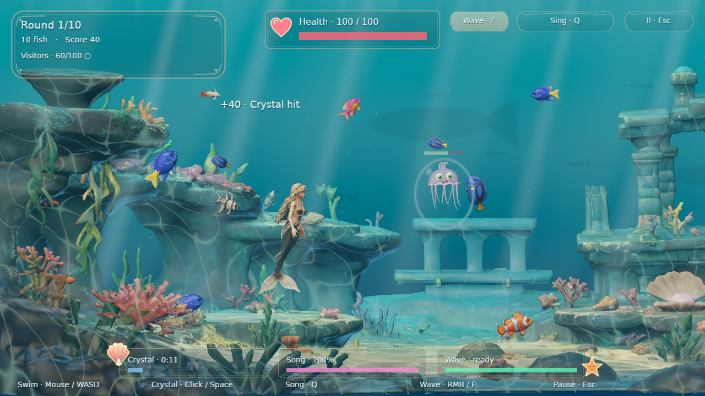
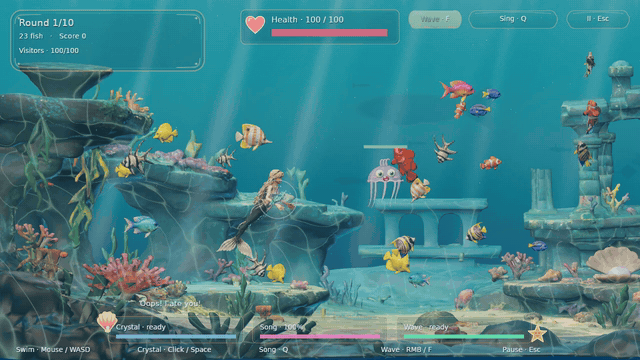

# Sabrinina podvodna bajka

**Sabrina’s Underwater Fairy Tale**

[](https://github.com/arvvoid/sabrinina-podvodna-bajka/actions/workflows/rust.yml)
[](https://github.com/arvvoid/sabrinina-podvodna-bajka/actions/workflows/github-code-scanning/codeql)
[](https://www.rust-lang.org/)
[](https://bevy.org/)
[](LICENSE)

This is a little underwater game I am making with my daughter Sabrina. You swim around the reef as a mermaid, look after the fish and deal with hungry jellyfish using a magic crystal, waves and song. There is also an aquarium mode if you just want to watch the fish and relax.



**This is the current Rust/Bevy version. It works and is playable, but it is still a work in progress.**

### See it in motion

[](docs/media/gameplay.mp4)

[Watch or download the 20-second gameplay video (MP4, 720p)](docs/media/gameplay.mp4). The short GIF loops without sound. The full video has the combat music. Both were captured from the actual game with scripted inputs, not rendered separately.

## How it started

This started as a [Scratch game](https://scratch.mit.edu/projects/1203591608/) I made together with my daughter Sabrina when she was four. The idea and game design were hers. I was there as dad, explaining things, helping her learn and doing the technical parts with her. We ended up with an underwater world full of fish, a hungry jellyfish and Sabrina the mermaid protecting everyone with magic.

I then tried turning it into a 3D game in Godot, before deciding to remake the whole thing in Rust and Bevy. The point was not to turn it into some completely different game. I wanted to keep the things Sabrina came up with: the side view, the voices, the crystal, the magic and the peaceful parts between attacks. It is still our little project, just a lot more ambitious now.

**Development:** Luka Dežulović

**Original idea:** Sabrina Dežulović

The Godot prototype is preserved on [`legacy_godot`](https://github.com/arvvoid/sabrinina-podvodna-bajka/tree/legacy_godot). `main` contains the Bevy game.

## Current status and release plans

The game is playable already, but I am still working on it. There are animations to improve, balance to tweak and plenty of testing left. I would like to release it on **Steam**, and later on **Android and iOS**. Those releases are planned, not available yet, and I am not setting a date until it is ready.

## Playing

**Ability HUD:** three clickable square icons at the bottom center activate
Wave, Song and Crystal, from left to right. Keyboard/mouse bindings appear below
each icon, switching to the active controller's labels and colors. Unavailable
abilities are muted; cooldowns reveal the icon's color clockwise, with remaining
time shown over it. Song uses the same sweep for its remaining/recharging energy.
The sweep is shader-rendered: only small progress uniforms change, not textures.

**Tail color:** open Settings → Tail color and choose **None**, **Natural green**,
**Violet**, **Pink**, **Lagoon blue**, **Coral**, **Gold**, or **Magic** using the
mouse, keyboard or controller. **None** keeps the original texture colors and
standard PBR lighting without recoloring. **Magic** creates a subtle,
continuous twirl of violet, pink and turquoise with a restrained colored sheen,
without pulsing brightness, white gleams or pastel glare.
One shared model-space pattern flows across the tail and fins without restarting
at texture seams. It runs entirely in the shader: no extra textures, texture
uploads or per-frame material changes. Reduced motion keeps the colors and
flow still. The choice is saved
locally and applies only to the tail and fins; hair and bikini retain their
original colors. Previously saved custom RGB colors remain intact until you
choose a preset.

Sabrina's skin, costume, tail and hair use a softer satin finish. Roughness is
limited after sampling the material maps, with normal-variation filtering to
reduce tiny sparkling white reflections without changing the scene lighting.
Only Magic gives the tail a shinier finish; the rest of Sabrina stays satin.

The fish swim around during the quieter parts. Every now and then jellyfish show up and try to eat them. Each jellyfish has **100 health** and only retreats after you bring that down to zero. There is no timeout or limit to the number of fish it can eat. If you lose all the fish during a round, or Sabrina loses all her health, it is game over. Jellyfish get bigger as they eat, and Sabrina slowly recovers if she stays safe for a while.

The goal is to protect the reef for **10 rounds**. Round 10 always sends **four jellyfish**, regardless of the visitor limit or whether you selected Gentle or Lively. Defeat all four with Sabrina still alive and at least one fish left, and you win. The end screen shows your score and surviving fish. There is no round 11. Aquarium mode keeps going indefinitely.

- **Crystal:** 40 damage and a 3-second air bubble. A bubbled jellyfish cannot swim, sting or eat, but waves can still push it. The crystal returns like a boomerang after a hit or miss; it recharges in 12 seconds from launch. Once returned, it immediately resumes orbiting, without glow or particles until ready to throw again. Gentle mode auto-aims; Lively uses a straight skillshot aimed by swimming before casting (horizontal while stationary).

- **Wave:** pushes fish away as before. Within 2.5 world units of the cast position it also pushes a jellyfish and deals 10 damage, once per visitor per cast. This checks the bell and tentacles, not just the centre, including at point-blank range. Recharge: 3 seconds.

- **Song:** gathers nearby fish, but can also attract jellyfish. Its reach shrinks with energy; exhausting it requires a complete recharge.

- **Progression:** each round slightly increases visitor speed and the probability of multiple visitors, up to the selected visitor limit. Speed growth is bounded; health and damage stay consistent.

I wanted the score to mean you actually did something, not that you left the game running. You get: **1 point per actual damage**, **100 per defeated visitor**, **50 per genuine fish rescue**, and **25 per surviving fish** after every visitor is defeated. A fish can earn only one rescue reward per round across all abilities. Crystal collection only scores for threatened fish; wave rescues require surviving and reaching clear water; song requires escorting a threatened fish to safety. Safe fish collection, missed attacks and passive waiting earn nothing. A sting still subtracts up to 100 points. Hit, rescue and survivor rewards appear immediately, and each visitor has a health bar.

You can choose Gentle or Lively, adjust how often jellyfish appear, or turn the whole thing into a peaceful aquarium without any competition. The visitor-limit setting applies to rounds 1–9 only. Best scores from the old scoring rules are reset once; the saved best remains a local single-round record, not a normalized leaderboard across custom settings. The obsolete spoken instructions have been removed; the localized written guide describes the current rules. Character voices and song remain.

| Action | Mouse / keyboard | Xbox | PlayStation |
|---|---|---|---|
| Swim | Pointer, WASD / arrows | Left stick | Left stick |
| Wave | Right click, F or HUD button | A (green) | × (blue) |
| Song | Q or HUD button | B (red) | ○ (red) |
| Crystal | Space or HUD button | X (blue), or right shoulder | □ (pink), or right shoulder |
| Pause | Escape | Start / Menu | Options |
| Fullscreen | F11 or Settings | Settings | Settings |

The game changes its button hints to match whichever controller you are using, including the button colours. With multiple controllers, hints follow the one most recently used; disconnecting all controllers restores keyboard/mouse hints. Unrecognized controllers use neutral bottom/left/right button labels. Detection uses the device name and USB vendor ID reported by the OS; remappers such as Steam Input may expose a different controller type. Keyboard/mouse input remains available while a controller is connected.

**Windows controllers:** the default backend is native **XInput**, for Xbox-compatible controllers and Steam Input's Xbox gamepad emulation. With Steam Input enabled, a DualShock/DualSense or other supported controller is intentionally presented with Xbox hints. Use Steam's **Gamepad** layout, not a keyboard/mouse-only layout. Input is polled on a separate thread at a requested 4 ms interval so observed short button taps are retained between rendered frames. XInput supports up to four controller slots; it does not directly recognize unconverted Sony/generic HID devices.

Use **`--wgi`** in the executable's arguments or Steam launch options to select the previous **Windows Gaming Input (Bevy/GilRs)** backend for direct Sony/generic controllers or comparison testing. Only one backend runs at a time. Direct-device input and vibration support depend on the driver and connection; seeing PlayStation hints is not a guarantee of vibration support. Linux and macOS keep Bevy/GilRs. The new Windows path has automated transport tests and a Windows cross-target type-check, but physical Windows/Steam Input playtesting is still required.

Menus support the **D-pad and left stick in all four directions**, following the on-screen layout. Holding a direction repeats after a short delay; stick hysteresis prevents jitter around the threshold. Left/right adjusts a selected slider. **A / × confirms, B / ○ goes back**, and Start / Options pauses or resumes. Release the stick after opening a menu before navigating. Tab / Shift+Tab still cycles through controls. Input and hints use the same active controller; a fresh button press or new deliberate stick movement switches controllers, not a continuously held stick on another device.

**Controller rumble** has saved **Off, Gentle and Normal** settings. Supported controllers receive brief, restrained pulses for crystal launches, hits, waves and damage to Sabrina—not continuous vibration while swimming or singing. Simultaneous effects do not stack; damage takes priority. Rumble stops on pause, focus loss, controller changes or exit. Support depends on the controller, driver and connection; unsupported devices remain playable without vibration.

On Windows's default XInput path, both motors are driven through `XInputSetState` on the same slot used for input. Pulse deadlines run independently of rendering, so a slow frame cannot prolong a pulse. Steam Input must provide a vibration-capable emulated gamepad and permit rumble. With `--wgi`, GilRs uses WGI vibration only for devices exposed as mapped WGI Gamepads; raw-controller detection alone is insufficient. See [Valve's gamepad-emulation guidance](https://partner.steamgames.com/doc/features/steam_controller/steam_input_gamepad_emulation_bestpractices), [GilRs's platform notes](https://docs.rs/gilrs/0.11.2/gilrs/#windows) and [Bevy's rumble contract](https://docs.rs/bevy/0.20.0/bevy/input/gamepad/enum.GamepadRumbleRequest.html).

HUD backgrounds and progress fills are semi-transparent. The lower-left foreground reef fades only slightly around Sabrina when it covers her (at most 25% transparent), leaving the rest of the scenery solid.

Enable **Show FPS counter** in Settings to display a small, smoothed frames-per-second counter in the upper-right corner, below the HUD buttons. It is off by default, works in menus and during play, and is saved with your preferences.

English, Croatian and Italian are available through the main menu's **Language… / Jezik… / Lingua…** button. Select a language by name in the chooser; a checkmark identifies the selected language. Graphics, sound, controls and best score are saved locally. The loading screen uses localized text and asset-loading progress, then waits for character instances before opening the menu. The first launch uses fullscreen and Balanced graphics.

| Graphics | Antialiasing | Shadows |
|---|---|---|
| Light | Off | Off |
| Balanced | Lightweight FXAA | Soft, single 1024×1024 map |
| High | 4× MSAA | More defined, soft single 2048×2048 map, including fish casters |

Shadowed sunlight has visible contrast, with neutral fill keeping shaded faces readable.
High enables fish-cast shadows; Balanced omits those extra skinned shadow draws.
The crystal and transparent jellyfish remain shadow-free.
**V-sync** is on by default. Bevy's `AutoVsync` selects relaxed FIFO when the surface supports it, otherwise standard FIFO. Relaxed FIFO presents late frames without waiting for another refresh, but those frames may tear; neither mode guarantees a frame rate. Turn V-sync off in Settings to request uncapped presentation and potentially reduce input latency (may tear; falls back to supported modes).

## Build and run

Install [Rust](https://rustup.rs/) first. I pin the toolchain and dependencies in `rust-toolchain.toml` and `Cargo.lock`, currently Rust 1.99.1 and Bevy 0.20.0, so everyone builds against the same versions.

On Debian/Ubuntu, install the native dependencies:

```sh
sudo apt install build-essential pkg-config libasound2-dev libudev-dev libx11-dev libxrandr-dev libxi-dev libgl1-mesa-dev libwayland-dev libxkbcommon-dev
./tools/build.sh
./tools/run.sh
```

The scripts use an optimized release build. Set `SABRINA_BUILD_JOBS=4` to limit compilation parallelism. On Windows, install Visual Studio C++ Build Tools; on macOS, install Xcode Command Line Tools. Build and run with:

```sh
cargo run --locked --release -p sabrina
```

### Graphics backend and testing matrix

| OS / target | Graphics backend | Build / distribution status | Runtime testing |
|---|---|---|---|
| Linux x86_64 | Vulkan | Desktop release workflow target; Ubuntu 24.04 baseline | Established tested desktop platform; gameplay and visual checks |
| Windows x86_64 (MSVC) | Direct3D 12 with embedded DXC | Desktop release workflow target; local release build verified | Tested on Windows 11 with an RTX 3070 Laptop GPU: rendered captures, live input/animation/effects checks and a 1080p 72-fish stress scene |
| macOS Apple Silicon | Metal | Desktop release workflow target; unsigned and not notarized | Not runtime-tested yet |
| Android (planned) | Vulkan | No mobile export available yet | Not tested |
| iOS (planned) | Metal | No mobile export available yet | Not tested |

#### Manual hardware testing

Additional playtesting results reported on 20 October 2026:

| System | CPU | GPU | Reported result |
|---|---|---|---|
| Intel Core i7-11800H | Intel UHD Graphics (Tiger Lake-H GT1) | Works well; 50-60 FPS, 60+ FPS lower graphics |
| Intel Core i7-11800H | NVIDIA GeForce RTX 3070 Laptop GPU, 8 GiB VRAM | Works well; 400+ FPS |
| Intel Core i7-2600K (older desktop) | NVIDIA GeForce GTX 1060 | Works well; stable 60+ FPS |

These are just results from machines I have tested, not proper comparable benchmarks and definitely not minimum requirements. Resolution, graphics quality, frame-limit settings and test scene were not recorded for these results. Development, fine tuning and requirement assessment still in progress.

Defaults are Direct3D 12 on Windows, Vulkan on Linux and Metal on macOS. See the runtime-options table for supported overrides. An unsupported flag warns and uses the platform default; if a selected backend cannot initialize, the game does not silently switch. OpenGL requires a compatible driver and, on Unix-like systems, an available EGL implementation.

Linux builds support both native Wayland and X11. By default, the window library automatically prefers Wayland when `WAYLAND_DISPLAY` or `WAYLAND_SOCKET` is nonempty, including when Xwayland also provides `DISPLAY`; otherwise it uses X11 when `DISPLAY` is available. Use `--x11` or `--wayland` to force a choice (`--X11` and `--Wayland` are accepted too). `--x11` requires `DISPLAY` and ignores Wayland session variables; `--wayland` requires a Wayland session and never falls back to X11. These flags select the window system independently of the Vulkan/OpenGL renderer and GPU. The loading screen shows the detected window system alongside the resolution and graphics-device details.


Windows x86_64 MSVC builds embed the modern DXC shader compiler in the executable. No separate `dxcompiler.dll` or installed Windows SDK is needed to play. This avoids the legacy FXC rendering path, which produced dark silhouettes on the tested NVIDIA Windows machine. To build on Windows, install Rust and Visual Studio's **Desktop development with C++** workload, including a Windows SDK and the **C++ ATL for latest build tools** component, then run the Cargo command above in PowerShell.


Blender is needed only to edit artwork.


#### Measured memory (20 October 2026 development build)

Linux x86_64 release build, Vulkan, NVIDIA RTX 3070 Laptop GPU / driver 595.99.02, Balanced graphics, V-sync on, embedded assets and default preferences:

| Scene | Resolution | Steady process RAM (RSS) | Peak process RAM | Sampled per-process GPU memory |
|---|---|---|---|---|
| Main menu | 1280×720 | 1435–1438 MiB | 1516 MiB | 837 MiB |
| Combat | 1920×1080 | 1437–1442 MiB | 1508 MiB | 851 MiB |
| 72-fish stress scene | 1920×1080 | 1384–1393 MiB | 1456 MiB | 851 MiB |

These are one measured run per scene, not requirements or allocation budgets. RAM was sampled from Linux `/proc/<pid>/status` after loading and before screenshot/teardown, with its high-water mark for the peak; GPU memory came from NVIDIA's per-process framebuffer samples. RSS includes resident mapped executable/assets and driver allocations, not just game-owned heap memory. Repeated runs varied: an earlier stress run reached about 1541 MiB peak RSS and 1105 MiB sampled GPU memory. OS, graphics driver/cache, settings and capture diagnostics affect the results; Windows and mobile memory have not been measured.

`./tools/package-bevy.sh` creates a portable directory under `dist/` containing the executable and accompanying documentation/license notices. The game is **asset-self-contained, not fully statically linked**: Linux still needs system libraries such as glibc, ALSA and libudev, and all platforms need their graphics drivers and OS windowing/audio support. Keep the accompanying notices when redistributing.

### Runtime options

Pass flags after the executable name, for example `./tools/run.sh --vulkan --capture-school --fullhd`.

| Flag / setting | Explanation |
|---|---|
| `--dx12` | Use Direct3D 12 on Windows (the default); ignored elsewhere. |
| `--vulkan` | Use Vulkan on Linux (default), or as a test override on Windows and macOS. |
| `--metal` | Use Metal on macOS (the default); ignored elsewhere. |
| `--opengl` | Use wgpu's GL/GLES backend on Windows, Linux and macOS for testing; requires a compatible driver and, on Unix-like systems, EGL. |
| `--x11`, `--wayland` | Linux only: force the X11 or Wayland window system instead of automatic desktop detection. Uppercase `--X11` and `--Wayland` spellings are also accepted. |
| `--direct-draw` | Force regular draw calls instead of Bevy's indirect drawing (the default on DX12). |
| `--indirect-draw` | Force Bevy's indirect drawing, overriding the DX12 direct-draw default. Indirect drawing remains the default on other backends. If both draw flags are passed, the last one wins. |
| `--wgi` | Windows only: use Bevy/GilRs Windows Gaming Input instead of native XInput. Allows direct-device testing; native XInput is the default for Xbox and Steam Input. |
| `--fullhd` | Use 1920×1080 instead of the default 1280×720 window resolution. |
| `--verify-input` | Use a fixed 60 Hz time step for deterministic input verification; opens windowed. |
| `--capture-game`, `--capture-visit`, `--capture-crystal`, `--capture-throw`, `--capture-wave`, `--capture-song`, `--capture-combat`, `--capture-finale` | Capture gameplay scenes; `finale` shows the final four-visitor round. |
| `--capture-school` | Run the 72-fish stress scene and report frame times and per-pass CPU/GPU timings. Add `--fullhd` for 1080p. |
| `--capture-boot`, `--capture-menu`, `--capture-settings`, `--capture-tail-color`, `--capture-language`, `--capture-help`, `--capture-credits`, `--capture-victory` | Capture the named screen. |
| `--capture-graphics-low`, `--capture-graphics-balanced`, `--capture-graphics-high` | Capture graphics-quality settings. |
| `--capture-pose-idle`, `--capture-pose-<name>`, `--capture-rig` | Capture Sabrina's idle pose, a named animation pose, or the character rig. |
| `--capture-pose-wave`, `--capture-pose-throw`, `--capture-pose-throw-gather` | Close-up push, crystal release, or wind-up. Append `-left`, `-climb`, `-dive` or `-upright` to check casting alignment. |
| `--capture-pose-stroke` | Run 20 seconds of close-up swimming cycles, holding Sabrina in frame for motion inspection. |
| `--capture-xbox`, `--capture-playstation`, `--capture-generic-pad` | Preview controller hints using a synthetic controller. |
| `--capture-occlusion`, `--capture-occlusion-solid` | Compare the foreground reef reveal with the solid-reef view. |
| `--capture-hr-<name>`, `--capture-it-<name>` | Capture any supported scene in Croatian or Italian. |
| `--capture-demo` | Run a seeded, scripted 20-second gameplay scene for recording. |
| `SABRINA_CAPTURE_FRAMES=/path` | Save 15 fps PNG frames while running `--capture-demo`. |
| `SABRINA_ASSETS=/path/to/assets` | Load an external asset directory instead of embedded assets. |
| `SABRINA_CAPTURE_AA=fxaa` | Enable FXAA in captures. |
| `SABRINA_BUILD_JOBS=4` | Limit build-script compilation parallelism. |

Captures are saved to the system temporary directory and do not save preferences.

## Tagged releases

Push a version tag to build and publish a GitHub release:

```sh
git tag v0.1.0
git push origin v0.1.0
```

The release workflow builds Linux x86_64 (Ubuntu 24.04 baseline), Windows x86_64 and macOS Apple Silicon packages. Archives include the asset-embedded executable, instructions, documentation and license notices, with a separate SHA-256 checksum for each download. Assets are not duplicated beside the executable. macOS packages are unsigned and not notarized. These are portable desktop packages, not Steam uploads or Android/iOS builds.

Tags must use `vMAJOR.MINOR.PATCH`, optionally followed by a prerelease suffix such as `v0.1.0-beta.1`. Tags with a suffix publish as prereleases. All platform builds and checks must succeed before publication. Release notes include installation guidance and GitHub's automatically generated changelog since the previous release. Creating a release does not replace platform playtesting or artwork-permission review.

## Music

I keep the original MIDI arrangements in `art/music/`. The game plays

stereo Ogg renders: underwater exploration at 96 BPM during calm play and menus,

jellyfish combat at 144 BPM during visits, and a short reveal stinger at the

start of each visit. Music crossfades between states and ducks beneath voices

and Sabrina's song. The stinger uses the music volume setting and is independent

of magic effects.

The two loops are padded to complete musical bars, with a warm-up pass retaining

notes and reverb across the seam. A 30 ms phase blend smooths the loop boundary

without shortening the bar. The stinger plays once with its release tail.

To regenerate the checked-in audio on Debian/Ubuntu:

```sh
sudo apt install libfluidsynth3 fluid-soundfont-gm ffmpeg python3-venv
python3 -m venv /tmp/sabrina-music-env
/tmp/sabrina-music-env/bin/pip install -r tools/requirements-music.txt
/tmp/sabrina-music-env/bin/python -m tools.render_music \
  --soundfont /usr/share/sounds/sf2/FluidR3_GM.sf2
/tmp/sabrina-music-env/bin/python -m unittest discover -s tests -v
```

Rendering dependencies are authoring-only; players need neither MIDI software

nor a soundfont. See [asset licensing](ASSET_LICENSE.md) for the compositions and

the included instrument-sample notice.

## Working on the game

- `src/reef_sim/`: engine-independent components, game rules and fixed-step simulation.

- `src/sabrina/`: Bevy input, presentation, animation, rendering, audio and UI.

- `assets/`: runtime models, embedded textures, audio, fonts, UI and WESL shaders.

- `art/`: maintained Blender sources and contact samples.

- `tools/`: build, export, packaging and validation scripts.

See [architecture](docs/ARCHITECTURE.md) and [art workflow](docs/CHARACTER_PIPELINE.md).

```sh
cargo test --locked --workspace
cargo fmt --all --check
cargo clippy --locked --workspace --all-targets -- -D warnings
python3 tools/validate_models.py
python3 tools/validate_render_lods.py
python3 tools/export_rust_contacts.py --check
./tools/run.sh --verify-input
```

## Next steps

- Refine animation, underwater lighting and encounter balance through playtesting.

- Broaden Windows hardware testing; test macOS and physical controllers.

- Add touch input and measure mobile hardware before Android/iOS/TV releases.

- Prepare store releases on Steam, Android and iOS once the game is ready.

## License

I release the source code, shaders, scripts, tests, configuration and technical documentation under [Apache 2.0](LICENSE). See [NOTICE](NOTICE) for authorship. The code may be reused and redistributed, including commercially, under that license.

The important distinction is that the code and the game content do **not** share the same license: Sabrina's characters, story and world, 3D models, textures, UI artwork, music and recordings are **all rights reserved**, to the extent held by their respective rights holders. The title and logo are reserved branding; the code license grants no trademark rights. Third-party assets retain their own licenses. See [ASSET_LICENSE.md](ASSET_LICENSE.md).

Official builds combine Apache-licensed code with separately licensed game content; selling them does not make the code proprietary or grant permission to redistribute the reserved content. Any future Steamworks or mobile-platform SDK files remain subject to their own terms and must not be published without permission.
